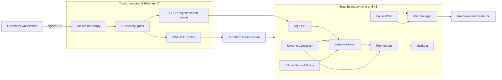

# Fortress

[](https://github.com/crimson9066/Fortress/actions/workflows/ci.yml)
[](https://github.com/crimson9066/Fortress/actions/workflows/ci.yml)
[](https://scorecard.dev/viewer/?uri=github.com/crimson9066/Fortress)

> Fortress is a secure, observable Kubernetes platform demonstrating least-privilege delivery, policy enforcement, runtime detection, and SLO-driven operations for a tiny Go service.

AWS resources are optional and ephemeral; kind is the primary local target.

## Architecture



Trust boundaries are explicit: GitHub CI is separate from the cluster, Argo
CD is the repository-to-cluster deployment boundary, and workload namespaces
are separated from platform components by admission and network policy.

## Quickstart

Prerequisites: Docker, kind, kubectl, Helm, Bash, and GNU Make. The Docker
daemon must be running.

```sh
git clone https://github.com/crimson9066/Fortress.git
cd Fortress
make cluster-up
make bootstrap
kubectl --context kind-fortress get nodes
kubectl --context kind-fortress -n kube-system get pods -l k8s-app=cilium
```

This creates one control plane and two workers, installs Cilium, and
bootstraps Argo CD. The documented target is under 10 minutes on a normal
developer workstation. This checkout was not timed because Docker, kind, and
Helm are unavailable in the current environment. Before syncing the workload,
replace its intentionally zero digest placeholder with a verified image digest
from the publish workflow; never use a tag. Details are in the
[local-cluster runbook](docs/runbooks/local-cluster.md).

## Control matrix

| Control | Implementation | Verification |
|---|---|---|
| Least-privilege CI | [.github/workflows/ci.yml](.github/workflows/ci.yml) | `actionlint .github/workflows/*.yml` |
| OIDC-only AWS access | [infra/terraform/modules/github-oidc](infra/terraform/modules/github-oidc) | `terraform -chdir=infra/terraform/envs/dev validate` |
| Encrypted Terraform state | [infra/terraform/bootstrap](infra/terraform/bootstrap) | `terraform -chdir=infra/terraform/bootstrap validate` |
| Non-root, restricted workload | [gitops/apps/items/base/deployment.yaml](gitops/apps/items/base/deployment.yaml) | `kubectl kustomize gitops/apps/items/overlays/prod` |
| Admission enforcement | [policies/kyverno](policies/kyverno) | `kyverno test policies/tests` |
| Network isolation | [gitops/apps/items/base/networkpolicy.yaml](gitops/apps/items/base/networkpolicy.yaml) | `kubectl kustomize gitops/apps/items/overlays/dev` |
| Signed image verification | [gitops/apps/observability/falco.yaml](gitops/apps/observability/falco.yaml) and [publish.yml](.github/workflows/publish.yml) | `grep -R "verifyImages" policies/kyverno` |
| Runtime detection | [observability/falco](observability/falco) | `kubectl kustomize observability/falco` |
| SLO alerting | [prometheusrule-slos.yaml](observability/monitoring/prometheusrule-slos.yaml) | `kubectl kustomize observability/monitoring` |
| Secret scanning | [ci.yml](.github/workflows/ci.yml) and [.pre-commit-config.yaml](.pre-commit-config.yaml) | `pre-commit run --all-files` |

## Verification

```sh
cd app && go test -race ./...
kubectl kustomize gitops/apps
kubectl kustomize policies/kyverno
kubectl kustomize observability/monitoring
kubectl kustomize observability/falco
```

The [threat model](docs/threat-model.md) records the current security
assessment and evidence for each threat.

## Known limitations

- The example workload image uses a zero digest placeholder until a published
  image digest is selected.
- Live kind, EKS, Falco, Alertmanager, and Scorecard results require their
  respective external services and are not fabricated in this repository.
- The Go service uses an in-memory store and is not horizontally consistent.
- Falco's host-level syscall capture requires a documented privileged platform
  exception.
- AWS cost and Terraform behavior depend on the selected region and account.

## What I would do next

- Run and record every [game-day scenario](game-day/README.md), including
  actual detection times and any remediation postmortems.
- Replace the example image digest with a release digest and verify the full
  kind quickstart on a clean workstation.
- Add durable application storage and a production-grade identity provider.

## Cost notes

AWS is optional. Review the [cost estimate and destroy checklist](docs/cost.md)
before creating any cloud resources. No apply or destroy is automated by this
repository.

## Demo GIF

Planned: add a short recording showing the kind bootstrap, a blocked Kyverno
deployment, and a Falco alert after a real game-day run.

## Suggested GitHub topics

`kubernetes`, `devsecops`, `platform-engineering`, `sre`, `terraform`, `argocd`,
`kyverno`, `falco`, `prometheus`, `supply-chain-security`
